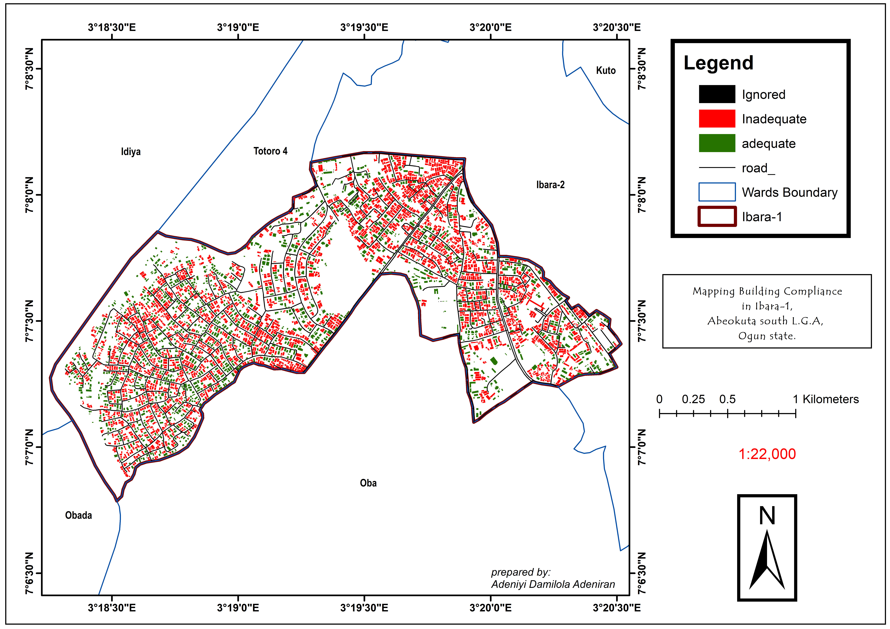

# Mapping Building Compliance with Air-space in Ibara ward 1, Abeokuta south LGA, Ogun state

## 1. THE PROBLEM

> Houses needs more than walls to provide a comfortable living environment, it needs enough open space around it for air, natural light and proper separation from neighbouring buildings. However, as neighbourhood develop, buildings occupy every avaliable spaces, living little room between one house to another. This raise an important question is the building in our neighbourhood meeting the required air-space standards?
---
## DATA USED
| Data | Source | Purpose | Type |
| --- | --- | --- | --- |
| OSM Building Footprint | OpenStreetmap | assess air-space compliance | spatial (polygon)
| Administrative Boundary Level 2,3 | GRID3 | accurately define and clip the analysis to the study area | spatial (polygon) |
| OSM Road | OpenStreetmap | show location and alignment to the study area | spatial (line) |

## 2. METHODS
### *The study area*
> The study was carried out in Ibara ward 1, located within Abeokuta south L.G.A in Ogun state. The ward is selected because of its recent  urban development, concentration of residential housing schemes, and growing built-up areas, making it suitable for this study.

*Figure below show the map of the study area*

### 3. ANALYSIS
* All spatial data  were projected to UTM zone 31N
* To minmise error arising from digitization and topology and also to remove kiosk, shops, among others polygon less than **30 sqm** were excluded fom the analysis
* A **1.5 m** buffer was created around each building footprint and intersecting buffered polygons were identified
* selected features attribute were updated and joined with the original building footprint
---
### 4. FINDINGS AND RECOMMENDATION
---
*Table below show the Comprehensive air space compliance analysis of the study area*

| SN | Description | count | % |
| --- | --- | --- | --- |
| 1 | Ignored | 100 | 1.9 |
| 2 | Not Adequate | 3539 | 67.8 |
| 3 | Adequate | 1684 | 32.2 |
|   | Total | 5223 | 100 |
---

> The analysis shows that 67.8% of assessed buildings have adequate spacing, while 32.2% have inadequate spacing, suggesting potential limitations in open space and natural air circulation; therefore, development control should be strengthened, with greater attention to building setbacks and minimum spacing requirements in future residential developments.
---
*Figure below show the Comprehensive air space compliance map of the study area*

> *prepared by: Adeniran Adeniyi Damilola*
> 
> *email: aadeniran374@gmail.com*
